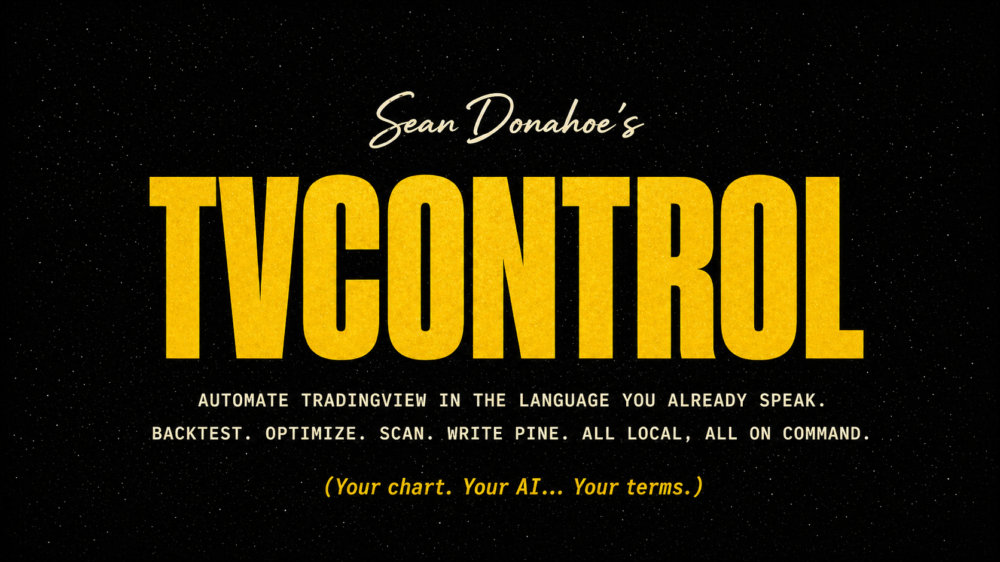

[](https://mseep.ai/app/ferroxlabs-tvcontrol)

<p align="center">
  
</p>

# TVControl

### TradingView MCP System · by [Ferrox Labs](https://github.com/ferroxlabs)

> **Tell your AI what you want from your TradingView chart. Watch it happen on screen.**

TVControl turns your TradingView Desktop into something you can talk to. You type a sentence (*"summarise this chart"*, *"sweep this strategy across SPY, QQQ and IWM on 5m and 15m"*, *"step through last March bar by bar and call out the breakout"*) and the AI reads, clicks, types, compiles and screenshots inside the actual TradingView app on your machine. No copy-paste and no TVControl-operated cloud backend. TradingView Desktop and explicitly selected public-API helpers still communicate with TradingView as documented.

It works because every Chromium app, TradingView Desktop included, ships with a built-in debugging interface (the same one Chrome uses to debug itself). TVControl speaks that interface on your behalf, exposing **113 chart-control and diagnostic tools** to any agent that speaks the Model Context Protocol. It is client-neutral: anything that can launch an MCP server over stdio works, and it is in daily use across several. Pair-program in Pine Script. Optimize parameter grids. Snapshot and restore whole chart setups. Drive 4-pane layouts. Step through replay. Scan a watchlist. All by speech-to-action.

**113 MCP tools · 938 deterministic offline tests · 10 verify scripts · 9 prompt-library workflows · no TVControl cloud backend.** Everything in this repo is real, tested, and used daily.

## What is new in 2.5

The 2.5 line is about one thing: **a tool must build its answer from an independent read, never from the request or from the response of the thing it just did.** Every fix below is a place where that was not true.

- **A result you can act on when a call times out.** `chart_set_symbol` and `chart_set_timeframe` had already applied the change by the time their readiness wait expired, then threw as though nothing had happened, so a caller that retried applied it twice. They now return `chart_ready: false` and say not to retry. `indicator_add_from_search` polls for the study instead of sleeping 1500ms and guessing. The contract is now stated in the tool descriptions: **a thrown error means nothing changed.**
- **`pine_open` no longer risks the wrong script.** It fetched a script's source and pasted it into whatever buffer was open, leaving the editor bound to the *previous* script while reporting success. A following save wrote over the wrong file. It now reads the editor's own title back and refuses on a mismatch. New in this release: **`pine_get_script_source`** reads a saved script over the REST API without touching the editor at all, which is what you want for comparing a saved script against a local file.
- **Screenshots are refused rather than stale.** A hidden tab returns the last frame Chromium painted for it: a real PNG of the right chart showing the wrong data, with the clock still ticking in the corner. `capture_screenshot` now requires a visible tab, and `region: "chart"` captures the *active* pane instead of whichever pane happened to be first in the DOM.
- **`replay_start` will not quietly move your date.** A date outside a symbol's replay depth was relocated silently, so every read afterwards was correct for a date nobody asked for. It now refuses, stops replay, and tells you where the cursor would have landed.
- **`tab_close` explains the dialog that is blocking it.** TradingView's unsaved-changes prompt is its own debug target, invisible to every selector the chart page can run, so the old failure read like a bug in tab handling. It is now found and named, and `discard_unsaved: true` answers it. "Save and close" is never clicked for you.
- **`draw_shape` refuses a shape name it does not recognise** instead of silently drawing a flag and echoing back the name you asked for.
- **The CLI can reach every safety guard the MCP tools expose.** Three of them were refusals whose own hint named a flag the CLI did not have.
- **The server starts even when it cannot read its own files.** Under restrictive install directories (Windows `Program Files` with Controlled Folder Access), a startup scan of its own tool directory threw before the server existed, and every client saw a bare `Connection closed`. Both startup reads now fail soft onto a catalog generated at publish time, and say so on stderr.
- **A contract for embedding TVControl in a desktop app** ships in the package: [`docs/EMBEDDING.md`](./docs/EMBEDDING.md). Read it before bundling this inside a host application.

See the [changelog](./CHANGELOG.md) and [upgrade guide](./docs/UPGRADING.md).


---

## What it actually does (with prompts that work)

Paste any of these into your MCP client once TVControl is wired up. Nothing here is specific to one agent.

**Read your chart in one prompt.**
> *Use `chart_vision_read` to summarise my chart: symbol, timeframe, last price, visible indicators with their current values, custom Pine levels and labels, and the last 100-bar move.*

A single tool call returns symbol, timeframe, indicator values, custom Pine drawings, OHLCV summary, and a screenshot. Roughly 5 to 10 KB back instead of ~80 KB across five separate calls.

**Pair-program in Pine Script.**
> *Write me a Pine v6 indicator that plots a 20-period EMA in blue and a 50-period EMA in orange, then compile it on my chart. Fix any errors. Save it as "EMA Cross".*

Inject, server-side compile, read errors, fix, save. The compiler errors come back to the agent directly, so iteration is seconds, not minutes.

**Optimize a parameter grid.**
> *Use `strategy_sweep` to test my current strategy across [`SPY`, `QQQ`, `IWM`] on `5` and `15` with `length` of 10, 14, 20 and `multiplier` of 1.5, 2, 2.5. Rank by net profit.*

Cartesian product, 24h-TTL disk cache (re-runs are near-instant), optional `parallelism: N` worker tabs, resume-from-partial. Caps at 500 combinations.

**Snapshot a setup. Restore it later.**
> *Snapshot my current chart as "morning-prep". Switch to BTCUSDT 4h with VWAP and Bollinger Bands. Done? Restore "morning-prep".*

Captures symbol, timeframe, all studies and their inputs, drawings, and the full `metaInfo` blob for published Pine, even ones that normally won't reload.

**Practice with replay.**
> *Start replay at 2025-03-10 09:30 ET. Step through the open. Call out any breakouts on the 1-min and simulate the entry. Show me the running P&L.*

**Scan a watchlist.**
> *For every symbol in my watchlist, take a 1-day chart screenshot, read the RSI(14), and rank by overbought-to-oversold.*

**Alert on everything you watch, without setting them one at a time.**
> *Set an alert 5% above the last price on every symbol in my watchlist, all pointing at `https://my-app.example/tv-hook`, on bar close, 1h. Show me the dry run first.*

One call. `alert_create_bulk` reads your active watchlist, prices each alert off that symbol's own last trade, and verifies the whole batch with a single read of the alert list afterwards. Everything lands on your webhook, so the filtering, grouping and deduping happen in your code rather than in your inbox.

The full prompt library (every workflow above plus chart analysis, watchlist and alerts, screening, and agent prompting tips) lives in [`examples/prompts/`](./examples/prompts/). Nine files. Copy-pasteable.

---

## How it stays grounded (the proof)

This isn't a demo. It ships with a test battery.

- **938 offline tests**: Pine analyzer, sanitization, replay, pane and indicator boundaries, watchlist, alerts, state snapshots, sweep planning, vision wrapper, telemetry, capability gating, privacy-safe bundles, chaos cleanup, soak bounds, golden workflows, native watchdog services, startup resilience, embedding contract, CLI/MCP guard parity, update safety, tool registration, and CLI routing. Live Pine-service checks are isolated in `tests/pine_api.test.js`.
- **Mutation-tested, not just green.** A test that cannot fail is worse than no test, because it turns an unknown into false confidence. Fixes in this project are checked by reintroducing the bug and confirming the suite goes red. Where behaviour lives in page-side JavaScript, the tests execute that generated code against a stub DOM rather than describing it in a mock.
- **The suite has a floor.** A run that reports fewer tests than expected fails, so tests cannot silently disappear from a green run.
- **10 end-to-end verify scripts** under [`examples/verify/`](./examples/verify/) that drive the same MCP tools through the `tv` CLI against a live TradingView. Run `examples/verify/run-all.sh` and it auto-skips when TV isn't up.
- **GitHub Actions CI** runs lint, offline tests, dependency audit, and package checks on Node 18 and 22 across Linux, macOS, and Windows.
- **CDP smoke** (`scripts/smoke.sh`): live connection sanity check against your local TradingView.

```bash
npm test                                    # offline suite
./examples/verify/00-verify-install.sh      # offline install check
./examples/verify/run-all.sh                # full live battery
```

If your version of TradingView reshapes some internal API, the verify battery is how you'll know within seconds.

---

## Quick starts

Install the current public release from npm:

```bash
npm install -g @ferroxlabs/tvcontrol
tv --help
```

The package installs both `tv` and `tvcontrol`. For MCP-server configuration, use the installed `src/server.js` or one of the repository paths below.

### Path A. Let your agent install it

Paste this into any coding agent that can edit files and run commands, and let it do the rest.

> Install the TVControl MCP server. Clone https://github.com/ferroxlabs/tvcontrol.git into ~/tvcontrol, run `npm install`, register it in my MCP client config as a server named `tvcontrol` running `node ~/tvcontrol/src/server.js`, then call `tv_launch` to start TradingView in debug mode and `tv_health_check` to confirm the connection.

It will clone, install, register the server, and verify. Restart your client when it finishes so the new MCP server loads.

### Path B. Manual, any MCP client

```bash
# 1. Clone and install
git clone https://github.com/ferroxlabs/tvcontrol.git
cd tvcontrol
npm install

# 2. Launch TradingView with the debug port enabled (one-time, per platform)
./scripts/launch_tv_debug_mac.sh        # macOS
./scripts/launch_tv_debug_linux.sh      # Linux
scripts\launch_tv_debug.bat             # Windows

# Or by hand on any platform:
/path/to/TradingView --remote-debugging-port=9222
```

On Windows Store/MSIX installations, `tv_launch` also detects the package with `Get-AppxPackage`. If Windows blocks CDP from the protected `WindowsApps` directory, it launches a versioned local copy under `%LOCALAPPDATA%\tvcontrol\desktop-cache` and reports `msix_local_copy: true`.

Then add this to your MCP client's config file, replacing the path with your own absolute path. Every MCP client uses the same shape; only the file location differs, and your client's documentation names it.

```json
{
  "mcpServers": {
    "tvcontrol": {
      "command": "node",
      "args": ["/absolute/path/to/tvcontrol/src/server.js"]
    }
  }
}
```

Restart your client. A copy-pasteable example config lives at [`examples/mcp-config.example.json`](./examples/mcp-config.example.json), including a variant with an absolute path to `node` for the case where your client launches servers without your shell's `PATH`.

**Bundling TVControl inside a desktop application?** Read [`docs/EMBEDDING.md`](./docs/EMBEDDING.md) first. It is the spawn contract, and it exists because the two ways an embed fails both happen before the server can emit a single message, so neither can report itself.

Verify with:
> *Use `tv_health_check`, then `chart_vision_read` to summarise my chart.*

If you get back a paragraph describing your actual chart, you're up.

### Path C. CLI only (no agent required)

Every MCP tool is also a `tv` command, JSON-out, jq-friendly. Skip the AI client entirely if you just want a programmable handle on your TradingView.

```bash
git clone https://github.com/ferroxlabs/tvcontrol.git
cd tvcontrol
npm install
npm link                          # optional: puts `tv` on your PATH

# launch TV with debug port (see Path B), then:
tv status                         # connection check
tv quote                          # latest price
tv ohlcv --summary                # compact stats
tv pine compile                   # compile current Pine on chart
tv stream quote | jq '.close'     # tick-by-tick price stream
```

---

## Examples directory map

| Workflow | File |
|----------|------|
| First 5 minutes | [`examples/prompts/00-quick-start.md`](./examples/prompts/00-quick-start.md) |
| Chart analysis | [`examples/prompts/01-chart-analysis.md`](./examples/prompts/01-chart-analysis.md) |
| Pine Script development | [`examples/prompts/02-pine-development.md`](./examples/prompts/02-pine-development.md) |
| Snapshot and restore chart state | [`examples/prompts/03-state-management.md`](./examples/prompts/03-state-management.md) |
| Strategy parameter sweeps | [`examples/prompts/04-strategy-sweep.md`](./examples/prompts/04-strategy-sweep.md) |
| Historical replay practice | [`examples/prompts/05-replay-practice.md`](./examples/prompts/05-replay-practice.md) |
| Watchlist and alerts | [`examples/prompts/06-watchlist-and-alerts.md`](./examples/prompts/06-watchlist-and-alerts.md) |
| Screening and optimization | [`examples/prompts/07-screening-and-optimization.md`](./examples/prompts/07-screening-and-optimization.md) |
| Agent prompting tips | [`examples/prompts/99-agent-tips.md`](./examples/prompts/99-agent-tips.md) |

Each prompt file lists the tools that fire, what to expect, and the common gotchas, so you can read it like a runbook before you paste, or pull it into your own automation.

---

## CLI surface

```
tv status / launch / state / symbol / timeframe / type / info / search
tv quote / ohlcv / values
tv data lines / labels / tables / boxes / strategy / trades / equity / depth / indicator
tv pine get / set / source / compile / analyze / check / save / new / open / list / errors / console
tv draw shape / list / get / remove / clear
tv alert list / create / delete
tv watchlist get / add / remove / export / import
tv indicator add / remove / toggle / set / get
tv layout list / switch
tv pane list / layout / focus / symbol
tv tab list / new / close / switch
tv replay start / step / stop / status / autoplay / trade
tv stream quote / bars / values / lines / labels / tables / all
tv ui click / keyboard / hover / scroll / find / eval / type / panel / fullscreen / mouse
tv screenshot / discover / ui-state / range / scroll
tv capabilities / support
tv chaos / soak / golden
tv compatibility / watchdog sample / watchdog history / watchdog service-plan
```

All commands return JSON. Core chart-control tools have CLI counterparts; long-running or disruptive reliability runners are deliberately CLI-first.

## Reliability toolkit

The compatibility layer checks the TradingView APIs required by each tool before execution. A tool is blocked only when the live canary explicitly confirms a required API is absent; if the canary itself is unavailable, recovery tools are still allowed to run.

```bash
tv capabilities                       # per-tool live capability matrix
tv support                            # redacted .json.gz support bundle
tv chaos                              # dry-run fault plan
tv chaos --allow-live-faults          # bounded disconnect/stall/tab recovery checks
tv soak --duration-ms 3600000         # health + stream + watchdog soak
tv golden                             # six receipt-producing live workflows
tv watchdog service-plan              # native service definition, no changes
tv watchdog install --apply           # launchd/systemd-user/Task Scheduler
```

Chaos is dry-run unless `--allow-live-faults` is present. Restore/sweep soak scenarios and snapshot/replay golden checks require `--allow-mutations`. Watchdog install and uninstall are dry-run unless `--apply` is present. Receipts are bounded and omit symbols, URLs, account-linked identifiers, source code, and raw error messages.

---

## Streaming

`tv stream` polls your local TradingView Desktop over CDP and emits JSONL. TVControl has no streaming cloud backend; TradingView Desktop continues to communicate with TradingView normally.

```bash
tv stream quote                          # tick-by-tick price
tv stream bars                           # bar-by-bar updates
tv stream values                         # indicator values
tv stream lines --filter "NY Levels"     # custom Pine levels
tv stream tables --filter Profiler       # Pine table rows
tv stream all                            # all panes at once
```

> [!WARNING]
> Programmatic consumption of TradingView data may conflict with their Terms of Use regardless of how it's accessed. You are solely responsible for compliance.

---

## Architecture

```
AI Agent  <->  MCP Server (stdio)  <->  CDP (localhost:9222)  <->  TradingView Desktop (Electron)
```

- **Transport:** MCP over stdio plus a `tv` CLI exposing the same surface.
- **Connection:** Chrome DevTools Protocol on `localhost:9222`.
- **Streaming:** poll-and-diff loop with deduplication, JSONL on stdout.
- **Runtime deps:** `@modelcontextprotocol/sdk`, `chrome-remote-interface`. That's it.

The full per-tool decision tree (*which tool to call for which question*) lives in [`CLAUDE.md`](./CLAUDE.md). The filename is a convention some clients load automatically; the content is plain Markdown and is worth reading whichever agent you use, or pasting into its own instructions file.

---

## How this stays safe to run

- The debug port is off in TradingView until *you* enable it via the standard `--remote-debugging-port=9222` flag.
- TVControl's chart-control path speaks CDP to the Electron app already running on your machine. TradingView Desktop and explicitly documented public helpers still communicate with TradingView.
- TVControl does not operate a cloud backend. Local snapshots, telemetry, reliability receipts, and support bundles are written only when their corresponding features are used.
- No real trades are executed. Chart, drawings, indicators, and Pine code only.
- **`TV_MCP_READONLY=1` registers only the tools that cannot change your TradingView state.** For unattended use (a scheduled morning brief, a cron job, a CI agent) where nobody is there to approve a call. An MCP grant is server-level, so a host that can reach TVControl can reach every tool it registers; under this flag the mutating ones are never registered, so calling one is an unknown-tool error rather than a promise the model is asked to keep. Reads, diagnostics, screenshots and chart navigation (symbol, timeframe, range, pane/tab/layout switching) stay available; watchlist edits, alert create/delete, drawing writes, indicator changes, Pine saves, replay, `state_restore` and `tv_launch` do not. `ui_evaluate` stays off even if `TV_MCP_ADVANCED=1` is also set.

The same CDP interface is built into every Chromium app: VS Code, Slack, Discord, Chrome itself. It's not a side door; it's the standard debugging interface Google ships with the runtime.

---

## Compatibility

- TVControl talks to undocumented internal TradingView APIs through the Electron debug interface. Those can change in any TradingView update without notice. Pin your TradingView Desktop version if stability matters to you.
- Tested on macOS, Windows, and Linux at release time.
- Requires Node.js 18.14.1 or newer.

---

## Disclaimer

This project is provided **for personal, educational, and research purposes only**.

By using this software, you acknowledge that:

1. You are solely responsible for ensuring your use complies with [TradingView's Terms of Use](https://www.tradingview.com/policies/) and all applicable laws.
2. TradingView's Terms of Use **restrict automated data collection, scraping, and non-display usage** of their platform and data. TVControl uses Chrome DevTools Protocol to programmatically interact with the TradingView Desktop app, which may conflict with those terms.
3. You assume all risk. Ferrox Labs and its contributors are not responsible for account bans, suspensions, legal actions, or any consequences resulting from use of this tool.
4. This tool **must not be used** for: redistributing or commercially exploiting TradingView's market data; circumventing TradingView's access controls or paywalls; performing automated live trading; or violating intellectual property rights of Pine Script authors.
5. Streaming functionality polls only your local TradingView Desktop instance; the Desktop app remains responsible for its normal TradingView network connection.
6. Market data accessed through this tool remains subject to exchange and provider licensing terms. **Do not redistribute, store, or commercially exploit it.**

TVControl is not affiliated with, endorsed by, or associated with TradingView Inc. *TradingView* is a trademark of TradingView Inc.

If you are unsure whether your intended use complies with TradingView's terms, do not use TVControl.

---

## Acknowledgements

TVControl began as a fork of [`tradingview-mcp`](https://github.com/tradesdontlie/tradingview-mcp) by **tradesdontlie**. That project established the core CDP-bridge approach and the original tool surface, and proved the whole "drive TradingView Desktop from an MCP agent" pattern was viable.

TVControl builds on that foundation with full state snapshot and restore (including the `metaInfo` blob for published Pine), Cartesian strategy sweeps with disk memoization and parallel worker tabs, the combined `chart_vision_read` one-shot, classified-error handling with remediation hints, opt-in JSONL telemetry, capability-aware runtime gates, privacy-safe diagnostics, watchdog services, chaos/soak/golden verification, an expanded offline test battery, end-to-end verify scripts, cross-platform GitHub Actions CI, and a curated prompt library.

Credit for the groundwork belongs to the upstream author. If you came here looking for the original, that's [right here](https://github.com/tradesdontlie/tradingview-mcp).

---

## License

MIT. See [LICENSE](./LICENSE).

The MIT license applies to the source code of this project only. It does not grant rights to TradingView's software, data, trademarks, or other intellectual property.

---

<p align="center">
  Built and maintained by <strong><a href="https://github.com/ferroxlabs">Ferrox Labs</a></strong>.
</p>
